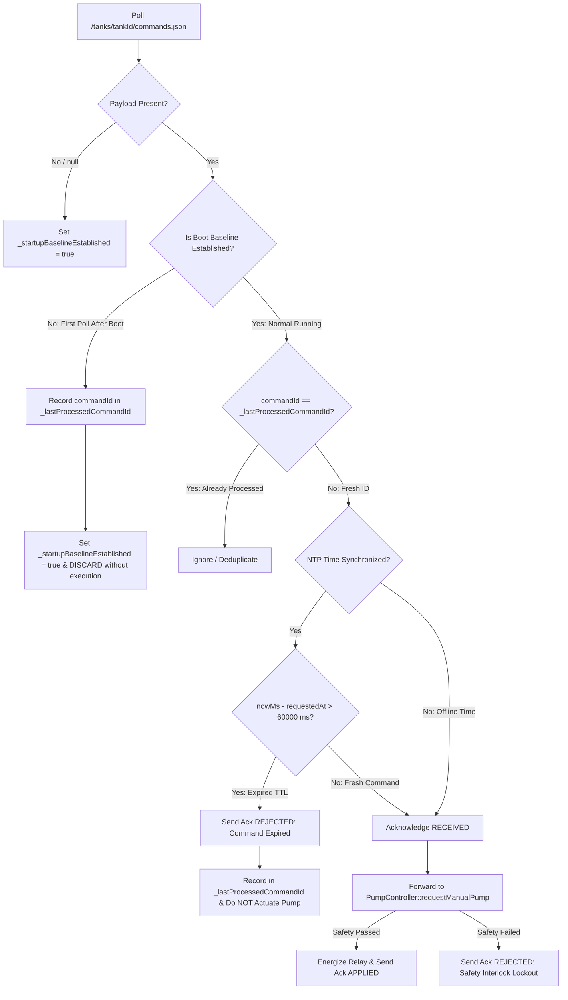

# Phase 4 Device Command Protocol Specification
## Smart Water Tank Monitoring System — Command Lifecycle, Replay Protection & Acknowledgements

**Document Reference**: `docs/phase-4/command-protocol.md`  
**Firebase Path**: `/tanks/{tankId}/commands` & `/tanks/{tankId}/commandAcks/{commandId}`  
**Security Fixes Documented**: `CMD-001` (Critical / P0) — Replay Attack & Stale Command Prevention  
**Status**: IMPLEMENTED AND VERIFIED VIA AUTOMATED REGRESSION SUITES  

---

## 1. Executive Summary

The Device Command Protocol defines how operator intentions expressed in the web dashboard are securely transmitted, validated, executed, and acknowledged by the edge ESP8266 controller.

To ensure safety and prevent physical catastrophes (e.g. historical commands causing a pump to turn ON unattended after a power cut), the protocol enforces:
1. **Strict Multi-Tenant Schema Validation**: Enforced at the Firebase RTDB security rule level.
2. **Three-Tier Replay Protection (`CMD-001`)**: Boot baseline establishment, command deduplication, and a strict 60-second time-to-live (TTL) expiry window.
3. **Four-Stage Acknowledgement Lifecycle**: Transparent tracking from receipt to physical relay actuation.

---

## 2. Command Data Model & Validation Schema

Commands are dispatched to `/tanks/{tankId}/commands`:

```json
{
  "commandId": "cmd_1718900123456_a1b2c3",
  "requestedMode": "MANUAL",
  "requestedPumpState": "ON",
  "requestedAt": 1718900123456,
  "requestedBy": "usr_operator_uid_987"
}
```

### 2.1 Field Constraints & Security Rules

| Field Name | Type | Constraints & Database Validation Rule | Description |
| :--- | :---: | :--- | :--- |
| **`commandId`** | String | `newData.isString() && length > 0 && length <= 64` | Globally unique identifier generated by the client. |
| **`requestedMode`** | String | `newData.val() === 'AUTO' \|\| newData.val() === 'MANUAL'` | Target controller mode. |
| **`requestedPumpState`**| String | `newData.val() === 'ON' \|\| newData.val() === 'OFF'` | Requested pump state. |
| **`requestedAt`** | Number | `newData.isNumber() && newData.val() >= 0` | UTC epoch timestamp in milliseconds. |
| **`requestedBy`** | String | `newData.val() === auth.uid` | Strict identity check preventing spoofing. |
| **`$other`** | - | `".validate": false` | Rejects payloads containing unexpected extra fields. |

---

## 3. The `CMD-001` Three-Tier Replay Prevention Architecture

In embedded systems polling cloud databases, network reconnects or reboots commonly replay stale records. The firmware implements three mandatory layers of protection in `firmware/src/cloud/FirebaseClient.cpp`:



### 3.1 Layer 1: Startup Baseline Establishment
When the ESP8266 boots, it does not know if a command currently resting in `/tanks/{tankId}/commands` was written 2 seconds ago or 2 days ago.
- On the **very first poll** after boot, the controller reads the command ID, stores it in `_lastProcessedCommandId`, sets `_startupBaselineEstablished = true`, and returns immediately **without actuating the relay**.
- Only commands written **after** boot are eligible for execution.

### 3.2 Layer 2: Command Deduplication
The controller retains `_lastProcessedCommandId` (64-character buffer). Across subsequent polling cycles (1000 ms cadence), any payload matching this ID is ignored without re-triggering relay transitions or duplicate database writes.

### 3.3 Layer 3: Time-To-Live (TTL) Expiry Verification
If the system time is synchronized via NTP (`configTime(0, 0, "pool.ntp.org")`):
$$\text{Age} = \text{nowMs} - \text{requestedAt}$$
- If $\text{Age} > 60,000\,\text{ms}$ (1 minute), the command is rejected as expired.
- An acknowledgement with `status: "REJECTED"` and reason `"Command expired: Timestamp older than 60s TTL threshold"` is written to the database.

---

## 4. Command Acknowledgement Lifecycle

Acknowledgements are stored at `/tanks/{tankId}/commandAcks/{commandId}`:

```json
{
  "commandId": "cmd_1718900123456_a1b2c3",
  "status": "APPLIED",
  "appliedAt": 84210.0,
  "reason": "Command successfully applied to relay output"
}
```

### 4.1 Permitted Status Values

| Status | Meaning & Validation Contract |
| :--- | :--- |
| **`RECEIVED`** | Edge controller successfully fetched and deserialized the command payload. |
| **`APPLIED`** | Command passed all pre-activation safety interlocks; relay output physically changed. |
| **`REJECTED`** | Command rejected by controller (e.g. TTL expired, tank level $\ge 95\%$, sensor fault, or safety lockout active). |
| **`FAILED`** | Hardware execution error or timeout. |

### 4.2 Distinguishing Command Acceptance from Physical Verification
- `APPLIED` indicates the **logical command was executed and the GPIO output was changed**.
- True physical verification is independently reported via live telemetry (`flowRateLpm > 0.5` and `pumpCurrentA > 0.2A`). The dashboard UI displays an "Executing / Water Flowing" badge only when independent sensor feedback confirms water movement.
