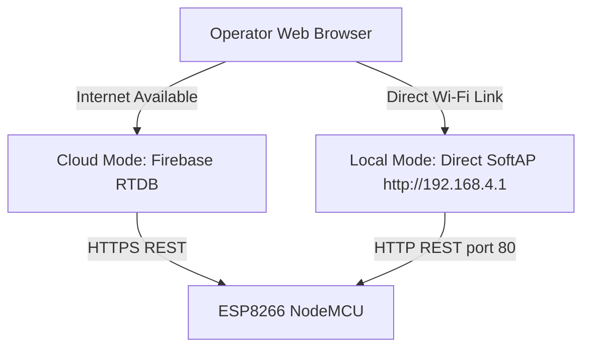

# Phase 4 Local HTTP API & Hybrid Dashboard Specification
## Smart Water Tank Monitoring System — Edge REST API, Session Security & Hybrid Routing

**Document Reference**: `docs/phase-4/local-api-integration.md`  
**Host IP & Port**: `http://192.168.4.1:80` (Embedded SoftAP) & Local LAN IP  
**Security Fixes Documented**: `SEC-002` (High / P1) — Local Endpoint Authentication & Rate Limiting  
**Status**: IMPLEMENTED AND VERIFIED  

---

## 1. Executive Summary

The ESP8266 controller features an onboard HTTP server (`LocalDashboardServer.cpp`) and DNS captive portal operating on port 80. This enables operators and maintenance technicians to connect directly to the tank's Wi-Fi network (`SmartTank-{tankId}`) using any smartphone, tablet, or laptop, access a full-featured real-time dashboard, and control the pump without relying on home routers, Internet links, or Firebase availability.

All sensitive endpoints are hardened per `SEC-002`:
- Cryptographically random session tokens with a 15-minute time-to-live.
- Strict rate-limiting: 5 consecutive failed login attempts trigger an immediate 30-second lockout.
- Removal of all insecure backdoor PINs or arbitrary username bypasses.
- Unified safety control: Local commands enter the identical `PumpController` validation path as cloud commands.

---

## 2. Local REST API Route Table

| HTTP Method | Route Path | Auth Required | Description & Constraints |
| :--- | :--- | :---: | :--- |
| **`GET`** | `/` | No | Serves embedded responsive HTML5/CSS3 local dashboard web app. |
| **`GET`** | `/api/live` | No | Returns instantaneous sensor telemetry and controller status. |
| **`POST`** | `/api/login` | No | Authenticates operator PIN, issues session token, enforces rate limits. |
| **`POST`** | `/api/command` | **Yes** | Dispatches mode change or manual pump ON/OFF command. |
| **`POST`** | `/api/wifi-setup`| **Yes** | Updates target Wi-Fi SSID, password, and tank ID in EEPROM. |
| **`GET`** | `/api/scan-wifi` | No | Returns list of nearby visible Wi-Fi networks and RSSI signal strengths. |
| **`OPTIONS`**| `/*` (All) | No | Handles CORS pre-flight requests (`Access-Control-Allow-Origin: *`). |

---

## 3. Endpoint Specifications & Schemas

### 3.1 `GET /api/live`
Returns live telemetry packet serialized by `handleApiLive()`:

```json
{
  "tankId": "tank-01",
  "levelPercent": "68.5",
  "distanceCm": "46.5",
  "flowRateLpm": "12.8",
  "totalLitres": "142.30",
  "pumpCurrentA": "2.10",
  "pumpState": "ON",
  "controlMode": "AUTO",
  "controllerStatus": "AUTO_FILLING",
  "sensorStatus": "OK",
  "lockout": "NONE",
  "faultCode": "NONE",
  "wifiConnected": true,
  "updatedAt": 128450.0
}
```

### 3.2 `POST /api/login`
Authenticates credentials and establishes a secure session:
- **Request Parameters** (`application/x-www-form-urlencoded` or query):
  - `pin`: Configured operator PIN (`admin123` by default).
- **Rate-Limiting Protection (`SEC-002`)**:
  - `_failedAuthAttempts` increments on every invalid PIN.
  - Upon 5 failed attempts, `_authLockoutUntilMs` locks the endpoint for **30 seconds**, returning HTTP 429:
    ```json
    { "success": false, "reason": "Rate limit exceeded. Try again in 30s." }
    ```
- **Success Response (HTTP 200)**:
  ```json
  {
    "success": true,
    "email": "operator@local",
    "tankId": "tank-01",
    "role": "operator",
    "token": "st_4a2c1f_7b9e01_1a3f89",
    "expiresIn": 900
  }
  ```

### 3.3 `POST /api/command`
Dispatches manual commands through the unified safety layer:
- **Headers / Parameters**:
  - `X-Auth-Token` header OR `token` param OR `pin` param.
  - `mode`: `"AUTO"` or `"MANUAL"`.
  - `pumpState`: `"ON"` or `"OFF"`.
- **Validation**:
  - If `token` is expired or invalid $\rightarrow$ HTTP 401 Unauthorized.
  - If `mode` is invalid $\rightarrow$ HTTP 400 Bad Request.
  - If `pumpState` is `"ON"` but tank level $\ge 95\%$ $\rightarrow$ HTTP 409 Conflict:
    ```json
    {
      "success": false,
      "reason": "Command rejected: High-water level cutoff exceeded (>= 95%)."
    }
    ```

---

## 4. Hybrid Dashboard Architecture & Network Constraints

The web dashboard supports dual-mode operation:



### 4.1 Browser Mixed-Content Security Considerations
Modern web browsers (Chrome, Edge, Firefox, Safari) enforce strict **Mixed Content Restrictions**:
- A dashboard hosted on an `https://` origin (e.g. Firebase Hosting `https://smart-water-tank.web.app`) **cannot** make unencrypted `http://` fetch requests to `http://192.168.4.1`. The browser blocks these requests as mixed-content security violations.
- **Supported Hybrid Usage**:
  1. **Direct Local Tab**: When connected to the tank's `SmartTank-{tankId}` SoftAP, the operator simply enters `http://192.168.4.1` into the browser address bar. The microcontroller serves the self-contained dashboard directly over HTTP, eliminating mixed-content restrictions.
  2. **Captive Portal Auto-Launch**: Most mobile operating systems (Android, iOS) automatically detect the captive DNS redirect and launch the embedded setup page upon joining the network.
  3. **Local Dev Server**: The local dashboard running on `http://localhost:5173` communicates with `http://192.168.4.1` without mixed-content blocking.
