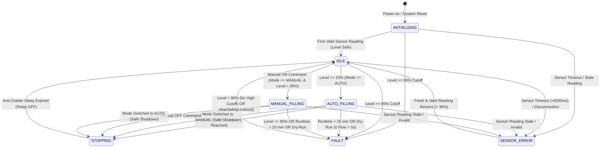

# Phase 4 Autonomous Pump Control & Safety Interlocks Specification
## Smart Water Tank Monitoring System — 7-State Machine, Interlocks & Relay Actuation

**Document Reference**: `docs/phase-4/pump-control-and-safety.md`  
**Target Hardware**: NodeMCU v2, 5V Opto-Isolated Relay Module on D6 (GPIO12)  
**Safety Philosophy**: Fail-Safe Closed (All faults de-energize the pump)  
**Status**: IMPLEMENTED AND VERIFIED  

---

## 1. Executive Summary

The pump controller in `firmware/src/control/PumpController.cpp` is the deterministic safety authority of the Smart Water Tank Monitoring System. It implements an explicit **7-state finite state machine** (`ControllerState`) that guarantees:
1. No external cloud command, operator action, or network failure can bypass hardware safety rules.
2. The relay defaults to safe de-energization during power-on, reset, brownout, and network disconnects.
3. Chatty transitions are eliminated through software anti-chatter timers and level hysteresis.
4. Pre-activation safety validation rejects unsafe manual requests before any relay state change occurs.

---

## 2. The 7-State Pump Control State Machine



---

## 3. State Definitions & Behavioral Rules

### 3.1 `INITIALIZING`
- **Entry**: Entered upon boot during `pumpController.begin()`.
- **Relay State**: FORCED OFF (Active-LOW: GPIO12 driven HIGH).
- **Behavior**: Waits for the ultrasonic transducer and current sensor to complete their startup settling windows. Transitions to `IDLE` once the first valid, fresh sensor reading is acquired.

### 3.2 `IDLE`
- **Entry**: Safe standby condition with pump de-energized.
- **Relay State**: OFF.
- **Behavior**:
  - In `AUTO` mode: Monitors water level. If `levelPercent <= 20.0%`, transitions to `AUTO_FILLING`.
  - In intermediate range ($20\% < \text{Level} < 95\%$): Maintains pump OFF to prevent relay cycling.
  - In `MANUAL` mode: Awaits authenticated manual ON commands.

### 3.3 `AUTO_FILLING`
- **Entry**: Triggered when tank water level falls to or below $20.0\%$ in `AUTO` mode.
- **Relay State**: ENERGIZED (Active-LOW: GPIO12 driven LOW).
- **Active Protections**:
  - Continuous runtime tracked via `_pumpStartTimeMs`.
  - Flow rate monitored after 15s startup grace period.
  - Water level monitored on every loop pass.

### 3.4 `MANUAL_FILLING`
- **Entry**: Triggered by authorized operator `requestManualPump(true)` in `MANUAL` mode.
- **Relay State**: ENERGIZED.
- **Safety Rule**: Must pass pre-activation validation. If water level is $\ge 95\%$, sensor data is invalid, or a lockout is active, the command is rejected **before** energizing the relay.

### 3.5 `STOPPING`
- **Entry**: Triggered when the fill target is achieved, when an operator requests manual OFF, or when the operating mode is switched during active pumping.
- **Relay State**: OFF.
- **Anti-Chatter Rate Limiting**: Enforces a minimum 5000 ms cooldown (`MIN_SWITCHING_INTERVAL_MS`) between consecutive relay state transitions to prevent mechanical relay wear.

### 3.6 `FAULT`
- **Entry**: Triggered by safety interlock violations:
  - `HIGH_LEVEL_CUTOFF`: Water level $\ge 95.0\%$.
  - `MAX_RUNTIME_EXCEEDED`: Continuous pump runtime $\ge 20$ minutes.
  - `DRY_RUN_DETECTED`: Zero flow ($Q \le 0.1\,\text{L/min}$) sustained for $> 5$ seconds after 15s grace.
- **Relay State**: FORCED OFF.
- **Recovery Policy**:
  - `HIGH_LEVEL_CUTOFF`: Automatically clears when water level drops below $90.0\%$.
  - `MAX_RUNTIME_EXCEEDED` & `DRY_RUN_DETECTED`: Latched. Requires operator intervention (`clearSafetyLockout()`) or system reboot.

### 3.7 `SENSOR_ERROR`
- **Entry**: Triggered if the ultrasonic reading is physically out-of-bounds ($<2\,\text{cm}$ or $>400\,\text{cm}$), transducer times out, or measurement is older than 5000 ms (`isStale`).
- **Relay State**: FORCED OFF.
- **Recovery Policy**: Automatically clears and transitions back to `IDLE` once fresh, valid sensor readings resume.

---

## 4. Mandatory Safety Interlocks Matrix

| Interlock Name | Trigger Condition | Safety Action | Recovery Policy |
| :--- | :--- | :--- | :--- |
| **High-Water Cutoff** | Level $\ge 95.0\%$ in ANY mode | Relay turned OFF immediately | Auto-clears when level drops $< 90\%$ |
| **Max Continuous Runtime** | Pump ON continuously $\ge 20$ min | Relay turned OFF immediately | Latched; requires manual lockout reset |
| **Dry-Run Protection** | Flow $\le 0.1\,\text{L/min}$ for $> 5\,\text{s}$ (after 15s grace) | Relay turned OFF immediately | Latched; requires manual lockout reset |
| **Sensor Failure / Timeout**| Invalid reading or Stale $> 5000\,\text{ms}$ | Relay turned OFF immediately | Auto-clears when valid reading returns |
| **Pre-Activation Interlock** | Manual ON requested while Level $\ge 95\%$ or Sensor Error | Command rejected; relay remains OFF | Re-evaluate upon next valid request |
| **Safe Mode Transition** | Switching between AUTO and MANUAL while pump is ON | Relay turned OFF immediately | Returns to IDLE in new mode |
| **Boot Glitch Prevention** | ESP8266 reset or power-up | GPIO12 driven HIGH before `pinMode(OUTPUT)` | Maintained until autonomous start condition |

---

## 5. Relay Electrical Driver Architecture (`HW-001`)

### 5.1 Active-Low Optocoupler Logic
Most standard 5V Arduino relay modules feature active-LOW optocoupler inputs:
- `GPIO12 = LOW` ($0\,\text{V}$): Optocoupler LED conducts $\rightarrow$ Relay Coil ENERGIZED $\rightarrow$ Pump ON.
- `GPIO12 = HIGH` ($3.3\,\text{V}$): Optocoupler LED off $\rightarrow$ Relay Coil DE-ENERGIZED $\rightarrow$ Pump OFF.

### 5.2 Boot-Safe Code Implementation
```cpp
void RelayDriver::begin() {
  // Drive pin to safe inactive level BEFORE declaring as OUTPUT
  if (_activeLow) {
    digitalWrite(_pin, HIGH); // Safe OFF for active-low
  } else {
    digitalWrite(_pin, LOW);  // Safe OFF for active-high
  }
  pinMode(_pin, OUTPUT);
  _isPumpOn = false;
}
```
This guarantees zero voltage glitches on the relay coil during the bootloader execution window.
